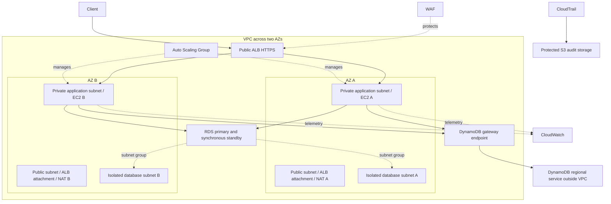
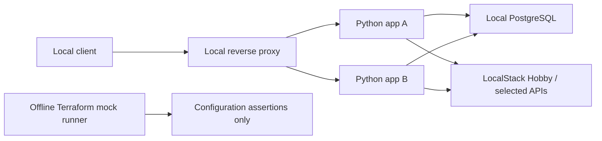

# Three-tier reference architecture

Status: accepted curriculum baseline; no resources implemented or AWS-qualified.
One region (nominal test fixture: `us-east-1`), two Availability Zones, three subnet
tiers per AZ. AZ names in tests are fixtures, not discovered account mappings.

ALB attaches to both public subnets; application instances have no public IPs.
The single RDS box represents a primary and standby in separate AZs, not one
physical database host. A standby is not a read-scaling target.

## Local implementation view

This is a future lab diagram, not an already-running system. There is no direct
equivalence between Compose networks and AWS routes/security groups. All local
components share one physical failure domain.

## Addressing and traffic

| Environment | VPC | Public subnets | Application subnets | Database subnets |
|---|---|---|---|---|
| dev | 10.20.0.0/16 | 10.20.0.0/24, 10.20.1.0/24 | 10.20.16.0/24, 10.20.17.0/24 | 10.20.32.0/24, 10.20.33.0/24 |
| staging | 10.30.0.0/16 | 10.30.0.0/24, 10.30.1.0/24 | 10.30.16.0/24, 10.30.17.0/24 | 10.30.32.0/24, 10.30.33.0/24 |
| prod | 10.40.0.0/16 | 10.40.0.0/24, 10.40.1.0/24 | 10.40.16.0/24, 10.40.17.0/24 | 10.40.32.0/24, 10.40.33.0/24 |

Public default routes target the IGW. Each application subnet targets its own AZ's
zonal NAT. Database subnets have no internet default route. Compare single-NAT,
per-AZ NAT, and endpoint-focused designs; document resilience and real-world cost.
None of these gateways is created in AWS.

Security-group intent: internet → ALB 443; ALB SG → application 8080; application
SG → PostgreSQL 5432. No public SSH or database access. TLS terminates at the ALB;
database connections use TLS. Private application HTTP is an explicit threat-model
tradeoff to review against backend TLS, not a claim that private traffic is encrypted.

Model S3/DynamoDB gateway endpoints and selected interface endpoints for secrets,
management and logging. Learn routing, endpoint policies, private DNS, and interface
endpoint security groups separately. NAT permits egress; it is not an ingress path
or a comprehensive firewall.

## Application and persistence

Small Python order API: create order, get order, liveness/readiness. PostgreSQL
owns transactions and a unique request key. Later DynamoDB receipts support
idempotency lookups; no cross-store atomicity is assumed. Test interruption between
writes and reconstruction of receipts from the authoritative order record.

Reference compute: launch template, encrypted EBS, IMDSv2, instance profile, ASG,
ALB target groups, health checks, and target tracking. Reference RDS: private subnet
group, KMS encryption, managed master secret, backups, Multi-AZ, deletion protection,
and a tested local restore procedure. Workload measurements will inform capacity;
we will not invent a verified availability SLO or managed-service RTO from mock tests.

## Planned module contracts

| Module | Inputs | Outputs / ownership |
|---|---|---|
| networking | CIDR, AZ-keyed subnet allocation, endpoint/NAT choices | VPC and subnet maps keyed by stable AZ identifiers |
| network-access | VPC ID, explicit traffic contract | ALB/application/database/endpoint security groups and rules |
| kms | key purpose and policy contract | encryption key ARNs; no secret material |
| relational-data | DB subnets, SG, KMS reference, recovery settings | endpoint and managed secret ARN |
| dynamodb | access-pattern-driven keys/indexes, encryption and recovery settings | table/index ARNs |
| identity | exact data/log resource ARNs | least-privilege role and instance profile |
| application-load-balancer | public subnet map, SG, certificate reference | target group and ALB identifiers |
| compute | application subnet map, SG, profile, target group, image reference | launch template/ASG identifiers |
| observability | log settings, compute/ALB identifiers | log destinations, metrics and alarms |
| audit | encryption and access policy contracts | audit storage and trail configuration |

Create log destinations before IAM policies that reference them; create dependent
alarms afterward. Split these responsibilities within observability when implemented
to avoid a module cycle. Provider configuration belongs in root harnesses. Use typed
variables, validation, documented outputs, explicit versions, and common tags.

Future layout: `modules/`, `stacks/three-tier/`, `environments/dev/`,
`environments/staging/`, `environments/prod/`, `tests/`, `lab/`, and `app/`.
Create those paths as exercises start, not as empty promises of implemented modules.

## Official references

- [AWS two-AZ private-server/NAT design](https://docs.aws.amazon.com/vpc/latest/userguide/vpc-example-private-subnets-nat.html)
- [RDS Multi-AZ DB instance behavior](https://docs.aws.amazon.com/AmazonRDS/latest/UserGuide/Concepts.MultiAZSingleStandby.html)
